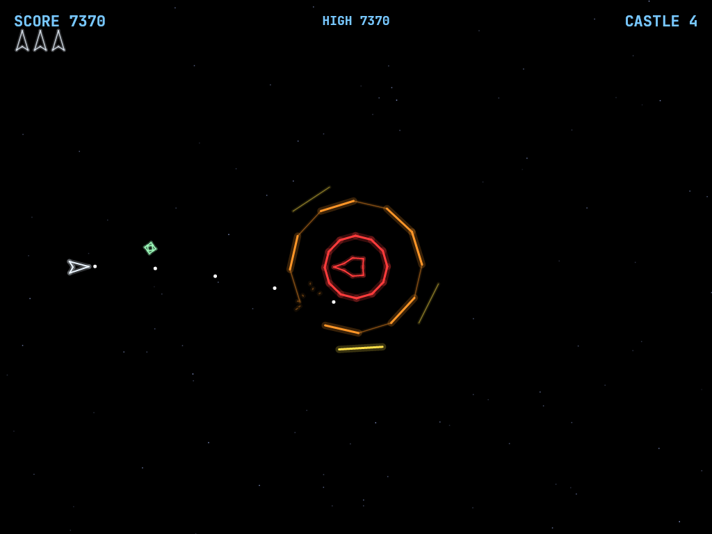
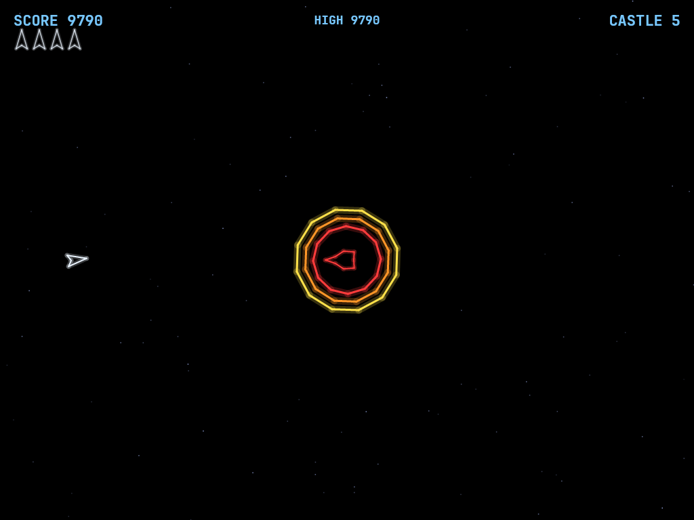
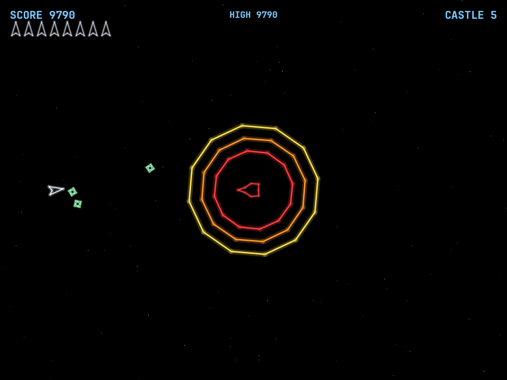
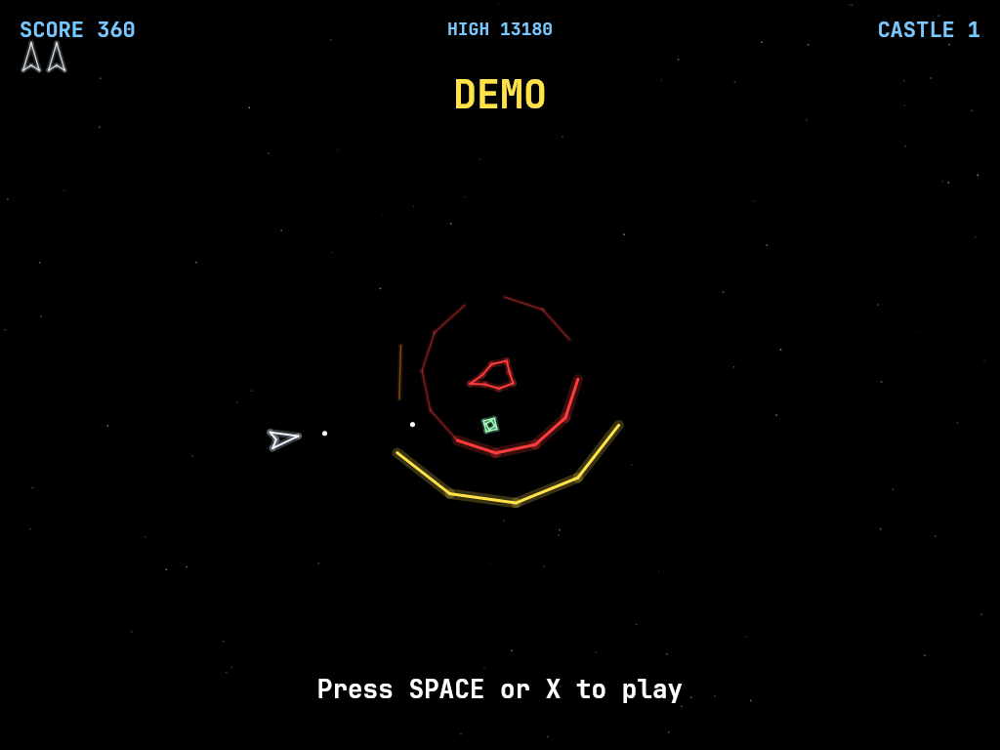
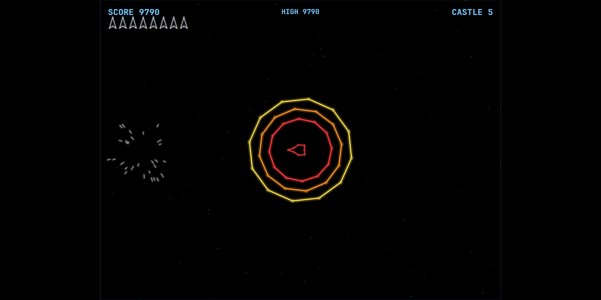
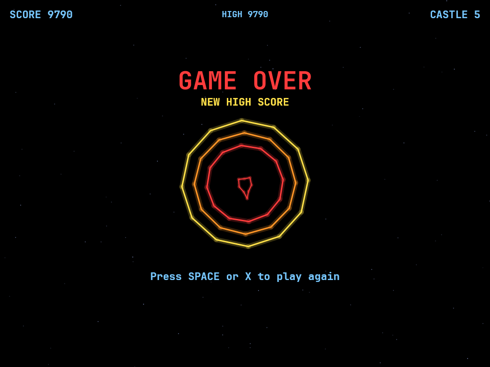
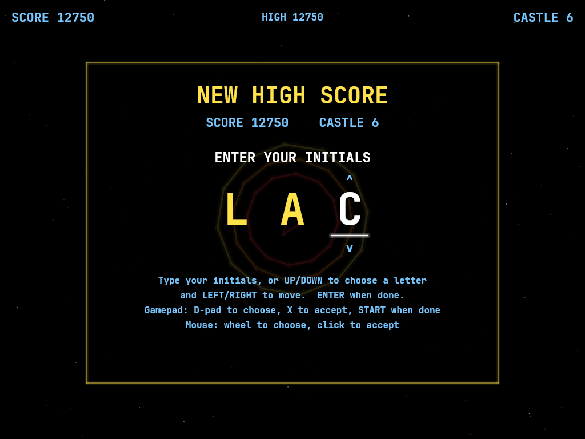
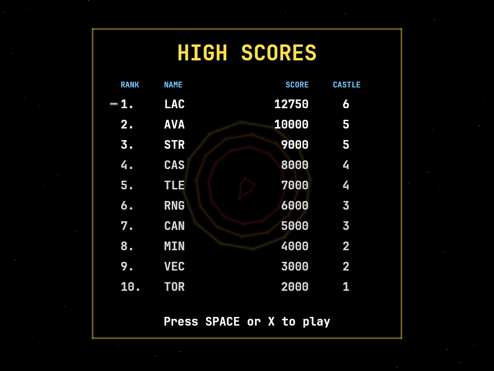

# AVACastle

A recreation of Cinematronics' 1980 vector arcade game **Star Castle**, built with .NET and Avalonia UI.
A cannon sits at the centre of the screen behind three counter-rotating energy rings. Shoot your way
through the rings, line up a gap, and hit the cannon, while it tracks you and fires through any opening it
can find, and homing mines hunt you down.

## Features

- **The Star Castle duel**: a tracking cannon behind three counter-rotating rings of 12 segments,
  each segment taking two hits.
- **Rings that fight back**: clear the outer ring and the other two move out while a new inner ring
  grows from the core, so the castle is never simply worn down.
- **A cannon that watches the gaps**: it follows your ship and fires a big, slow starburst the moment
  it can see you through all three rings, with a white flare as warning.
- **Homing mines** that leave the core sideways and curve round to come at you from the flank.
- **Solid rings**: your ship bounces off standing segments, so you can't fly through the castle.
- **Endless castles**: each destroyed cannon pays 2000 points and an extra ship, then a faster
  castle grows in its place.
- **Vector-monitor look**: glowing lines, a twinkling star field, and ring colours that come from
  their position on screen, like the original cabinet's plastic overlay.
- **Any window size**: the 4:3 playfield scales to fit, letterboxed.
- **Keyboard, mouse and gamepad** (Xbox, PlayStation, Switch Pro and other SDL2 controllers,
  hot-plugged).
- **Synthesised sound effects** and a **background drone** that throbs and climbs in pitch as the
  castles get harder, all generated by a small script you can edit.
- **Attract mode**: leave the title screen alone for 20 seconds and a computer pilot plays a silent
  demo game, like an arcade cabinet waiting for a coin.
- **Top-ten high-score table** with arcade-style initials entry (keyboard, gamepad or mouse),
  kept between games and shown in the title screen's idle cycle.
- **Ctrl+S** saves a screenshot.
- **One self-contained executable** per platform: Windows, macOS and Linux on Intel/AMD and ARM.

## Screenshots

| Title screen | Breaking in | The cannon fires |
|:------------:|:-----------:|:----------------:|
|  |  |  |
| Controls, scoring and the high score over a turning castle. | The outer ring is gone: the others move out while a new red ring grows from the core. | A tunnel through all three rings: the cannon fires its starburst at you, while a mine comes round the side. |

| Castle destroyed | A new castle | Mines closing in |
|:----------------:|:------------:|:----------------:|
|  |  |  |
| A shot gets through to the cannon and the whole castle goes up. | The next castle grows out of the crater, its rings nested as they expand. | Three homing mines converge on the ship. |

| Attract mode | Any window size | Game over |
|:------:|:---------------:|:---------:|
|  |  |  |
| Left alone on the title screen, the game plays itself, silently, until you press fire. | The playfield keeps its shape in a wide window, letterboxed. | The castle keeps turning while you decide whether to go again. |

| Entering initials | The high-score table |
|:-----------------:|:--------------------:|
|  |  |
| A score that makes the top ten earns three initials, typed or dialled in arcade style. | The new entry flashes in the table, which also appears between the title screen and the demo. |

## Download and run

Ready-to-run builds for Windows, macOS and Linux, on both Intel/AMD and ARM, are on the
[Releases page](https://github.com/Harlock123/AVACastle/releases). **Latest build** is rebuilt on
every push to `main`. Each download is one self-contained executable: no .NET install is
needed.

```bash
tar -xzf AVACastle-linux-arm64.tar.gz     # or linux-x64, linux-arm, osx-arm64, osx-x64
./AVACastle
```

On Windows, unzip `AVACastle-win-x64.zip` (or `-win-arm64`) and run `AVACastle.exe`. On macOS, if
Gatekeeper refuses to open it, run `xattr -d com.apple.quarantine AVACastle` once.

### Linux: sound and gamepads

- **Sound** needs `aplay`, from the `alsa-utils` package. Without it the game runs but is
  silent. Minimal installs (Arch, Omarchy, some Raspberry Pi images) don't include it:

  ```bash
  sudo apt install alsa-utils             # Debian / Ubuntu / Raspberry Pi OS
  sudo pacman -S --needed alsa-utils      # Arch / Omarchy
  ```

- **Gamepads** use SDL2. It is bundled for Windows, macOS and Intel/AMD Linux, but **ARM Linux builds need it
  installed**. Without it the keyboard still works; only the controller does not:

  ```bash
  sudo apt install libsdl2-dev            # Debian / Ubuntu / Raspberry Pi OS
  sudo pacman -S --needed sdl2-compat     # Arch / Omarchy
  ```

  On Debian-based systems it has to be `libsdl2-dev`: the game looks for `libSDL2.so`, which
  the runtime-only `libsdl2-2.0-0` package doesn't provide.

## Requirements

- .NET 9.0 SDK
- Compatible with Windows, macOS, and Linux

SDL2 is bundled for Windows, macOS and Intel/AMD Linux; ARM Linux needs it installed (see
[Linux: sound and gamepads](#linux-sound-and-gamepads)).

## Building and Running

```bash
cd AVACastle
dotnet build
dotnet run
```

## Controls

### Keyboard

| Key | Action |
|-----|--------|
| **W** / **Up Arrow** | Thrust forward |
| **A** / **Left Arrow** | Rotate left |
| **D** / **Right Arrow** | Rotate right |
| **Space** | Fire |
| **M** | Mute / unmute |
| **ESC** | Pause game |
| **ESC** (while paused, or on the title screen) | Exit game |
| **Any key** (while paused) | Resume game |
| **Space** (on title / Game Over) | Start a game (or **X** on a controller) |
| **Space** (during the demo) | Start a game |
| **Any other key** or **ESC** (during the demo or the high-score table) | Back to the title screen |

### Entering initials

| Input | Action |
|-------|--------|
| **A**–**Z**, **0**–**9**, **.** | Type a letter and move to the next |
| **Up** / **Down** | Step the current letter through the alphabet |
| **Left** / **Backspace**, **Right** | Move between letters |
| **Space** | Accept the current letter and move on (on the last letter, finish) |
| **Enter** / **ESC** | Finish |
| Gamepad **D-pad** or **stick** | Up/down choose a letter (hold to repeat); left/right move |
| Gamepad **X** / **B** / **A** | Accept the letter; **Start** finishes |
| Mouse **wheel** / **left click** | Choose a letter / accept it |

### Mouse

| Input | Action |
|-------|--------|
| **Left Button** | Fire |
| **Right Button** | Thrust forward |
| **Scroll Wheel** | Rotate ship |

### Controller (Xbox/PlayStation/Switch Pro)

| Input | Action |
|-------|--------|
| **Left Stick** / **D-Pad** | Rotate and thrust |
| **A** / **Right Trigger** | Thrust forward |
| **X** / **B** / **Bumpers** | Fire |
| **Start** | Pause / Resume game |
| **Back/Select** (while paused) | Exit game |

Controllers are automatically detected when connected. The game supports Xbox, PlayStation, Switch Pro, and most SDL2-compatible controllers.

### Other

| Key | Action |
|-----|--------|
| **Ctrl+S** / **Cmd+S** | Save screenshot to Pictures folder |

## Gameplay

- **The castle**: a cannon at the centre, behind three rings of 12 segments each. The outer ring
  and inner ring turn one way, the middle ring the other.
- **Breaking in**: each segment takes two hits. A damaged segment glows dimmer. Your shots stop at
  the first standing segment they meet, so you have to open holes and wait for them to line up.
- **Rings rebuild**: clear the whole outer ring and the middle and inner rings move out a slot each,
  while a fresh inner ring grows out of the core.
- **The cannon** turns to follow you. Whenever it has an open line to your ship through all three
  rings, it flares white and fires a big, slow starburst. Keep moving.
- **Mines** leave the core, drift out through the rings, then curve round and chase you. They burn
  out after a while, and can be shot.
- **The rings are solid**: your ship bounces off standing segments. Touch the cannon itself and
  you're done.
- **Destroying the cannon** blows up the whole castle and earns an extra ship. A new castle grows in
  its place, with faster rings, a quicker cannon and faster mines.
- You start with 3 ships; after losing one you reappear at the edge of the screen furthest from
  danger, briefly invulnerable (the ship flashes).
- The screen wraps around at the edges, for you and for the mines. The cannon's shots don't wrap.
- **High scores**: the top ten are kept, with initials and the castle each player reached. A
  fresh table starts with modest made-up scores (10,000 down to 1,000), the way arcade machines
  shipped, so there's something to beat; a best score from an earlier version of the game is
  carried in as `???`. When a game ends with a score that makes the table, **GAME OVER** shows for
  two seconds, then you enter three initials (your last ones are offered to start with). Input is
  ignored for the first moment, so a fire button still being mashed doesn't enter letters, and
  after 45 seconds untouched the initials are taken as they stand. The table then appears with your
  entry flashing. Closing the window mid-entry still keeps the score.
- **Attract mode**: after 20 seconds untouched on the title screen, the game plays itself, silently,
  with **DEMO** on screen. The pilot keeps a stand-off orbit, sidesteps the cannon when it charges,
  shoots mines that get close and chips away at the rings. It makes mistakes now and then, so it
  does lose ships. A demo lasts up to a minute, or until the pilot is out of ships, then the title
  comes back. The full idle cycle is title screen (20 seconds), high-score table (10 seconds), demo,
  and round again. Press fire to jump straight into a game; any other input
  returns to the title. Demo scores never count toward the high score. The Game Over screen goes
  back to the title after 20 seconds idle too.

## How to play

1. **Pick a spot and open a hole.** Hover a few ship lengths outside the outer ring and fire at the
   centre. Each segment needs two hits; a damaged one glows dimmer. Because the rings turn, a
   stream of fire chews a curved channel rather than a single notch.
2. **Work inward.** Once the outer ring has a gap facing you, your shots reach the middle ring, then
   the inner one. The rings turn at different speeds and in different directions, so the holes
   only line up for a moment.
3. **Time the kill shot.** When you see daylight through all three rings, fire. Your shot reaches the
   centre in well under a second.
4. **Watch the cannon.** The same open line that lets you hit the cannon lets the cannon hit you. When
   it flares white it is about to fire: thrust sideways out of its line. The starburst is slow
   and doesn't wrap around the screen, so a short sidestep is enough.
5. **Keep moving for the mines.** Mines leave the core and swing round to come at you from the side
   or behind. Turn and shoot them, or drift away until they burn out (they flicker first).
6. **Don't over-clear.** Destroying the entire outer ring isn't a win: the rings move out and a fresh
   inner ring appears. It is usually better to cut one deep, narrow tunnel than to strip a whole ring.
7. **Use the bounce.** Standing segments are solid, and the ship bounces off them at reduced speed.
   It's a handy brake, but touching the cannon itself through a gap is fatal.

Each castle you destroy is worth 2000 points and an extra ship (up to 9), and the next one is
harder: the rings spin faster, the cannon turns and reloads quicker, its shots fly faster, and the
mines are quicker and more agile.

## Scoring

| Target | Points |
|--------|--------|
| Outer ring segment | 10 |
| Middle ring segment | 20 |
| Inner ring segment | 30 |
| Cannon | 2000 + an extra ship |

## Sound Effects

All effects are synthesised by [`tools/make_sounds.py`](tools/make_sounds.py) into `Sounds/`; edit
it and run `python3 tools/make_sounds.py` to change them.

- **Fire**: your shot
- **Hit** / **Break**: a segment is damaged / destroyed (Hit also plays when you bounce off a ring)
- **Fireball**: the cannon fires
- **Mine**: a mine leaves the core
- **Regenerate**: the rings move out, or a new castle appears
- **Explosion** / **CastleBoom**: your ship / the castle is destroyed
- **ExtraLife**: an extra ship is awarded
- **Thruster**: loops while thrusting
- **Drone** (`Drone1`–`Drone4`): the castle's low, throbbing hum, looping while a castle stands.
  It steps up in pitch and throbs faster every two castles (castles 1–2, 3–4, 5–6, then 7 on), falls
  silent while the castle is a crater, on pause and at game over, and comes back with the next
  castle. Every throb fades to silence, and each loop ends on one, so the brief restart between
  loops is never heard.

## Project Structure

```
AVACastle/
├── AVACastle.sln
├── AVACastle.csproj
├── Program.cs
├── App.axaml / App.axaml.cs
├── MainWindow.axaml / MainWindow.axaml.cs
├── Images/                 # README screenshots (rendered off-screen from the game itself)
├── Models/
│   ├── GameObject.cs       # Base class with position, velocity, collision
│   ├── Ship.cs             # Player ship with thrust and rotation
│   ├── Bullet.cs           # Player shot; remembers its last position for swept ring hits
│   ├── Ring.cs             # One rotating 12-segment energy ring
│   ├── Castle.cs           # The three rings and the tracking cannon
│   ├── Fireball.cs         # The cannon's shot
│   ├── Mine.cs             # Homing mine
│   └── Explosion.cs        # Coloured particle explosions
├── Engine/
│   ├── GameEngine.cs       # Game loop, state, collisions, scoring, high score, attract cycle
│   ├── AttractPilot.cs     # The computer pilot that flies the attract-mode demo
│   ├── HighScoreTable.cs   # The top-ten table: load, qualify, insert, save
│   ├── InitialsEntry.cs    # Arcade-style three-letter initials entry
│   ├── InputHandler.cs     # Keyboard, mouse, and controller input
│   ├── ControllerManager.cs # SDL2 gamepad support
│   └── SoundManager.cs     # Cross-platform audio playback, including the looping drone
├── Views/
│   └── GameCanvas.cs       # Scales the 1024x768 playfield to the window and draws it
├── Sounds/                 # Generated WAV effects and the four drone loops
└── tools/
    └── make_sounds.py      # Synthesises the sound effects
```

## Technical Details

- **Framework**: Avalonia UI 11.x on .NET 9
- **Audio**: NetCoreAudio for cross-platform sound playback
- **Controller**: SDL2 GameController API for cross-platform gamepad support
- **Rendering**: Custom `Control` with `DrawingContext`. Every line is drawn twice, wide and faint and
  then thin and bright, for a vector-monitor glow. The ring colours come from their position on
  screen, the way the original cabinet coloured its black-and-white monitor with a plastic overlay.
- **Playfield**: a fixed 1024x768 field, scaled to fit any window size with letterboxing
- **Ring hits**: tested along the path each bullet travelled that frame, so fast shots can't skip
  through a ring between frames
- **Game Loop**: 60 FPS using `DispatcherTimer`
- **High scores**: saved to `AVACastle/highscores.txt` in the user's application-data folder
  (`~/.config` on Linux, `%APPDATA%` on Windows, `~/Library/Application Support` on macOS); one
  `INITIALS|score|castle` line per entry, written to a temporary file and swapped in
- **Screenshots**: Captured using `RenderTargetBitmap` and saved as PNG

## Roadmap

### Done

- The castle: three counter-rotating 12-segment rings with two-hit segments, ring shifting and
  regrowth, and a tracking cannon that fires through open lines
- Homing mines, solid rings the ship bounces off, and rising difficulty with each castle
- Overlay-coloured vector glow rendering, a twinkling star field, and a scalable 4:3 playfield
- Keyboard, mouse and hot-plugged SDL2 gamepad input
- Synthesised sound effects and a looping background drone that rises with each pair of castles
- Attract mode: a silent demo game flown by a computer pilot when the title screen is left alone
- Top-ten high-score table with arcade-style initials entry, screenshots, mute
- Self-contained single-file releases for 8 platforms on every push to `main`

### Planned

- Two-player alternating games
- Optional tuning settings (ring speed, cannon reload, starting ships)
- An unlimited-ships practice mode

## Credits

Star Castle was designed by Tim Skelly and programmed by Scott Boden for Cinematronics (1980). This is
a fan recreation of its gameplay; no code, graphics or sound from the original are used.

## License

MIT License
