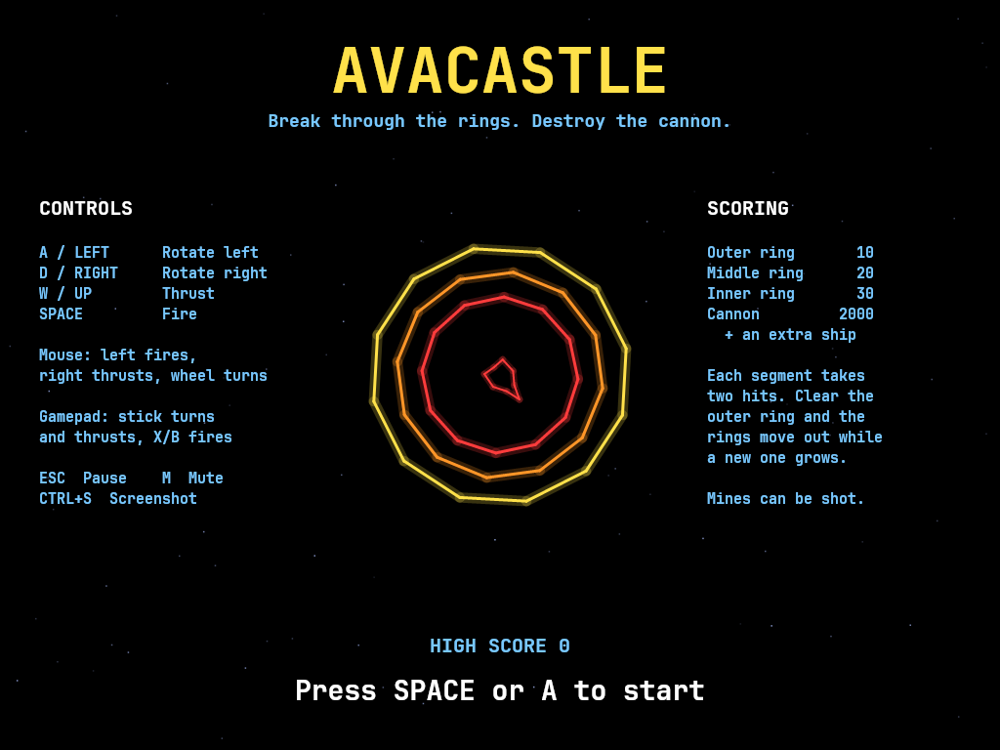
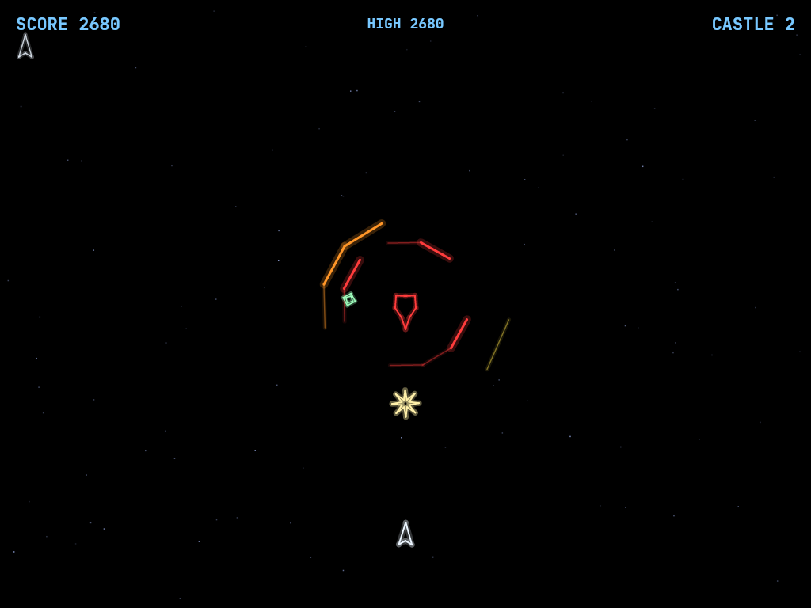
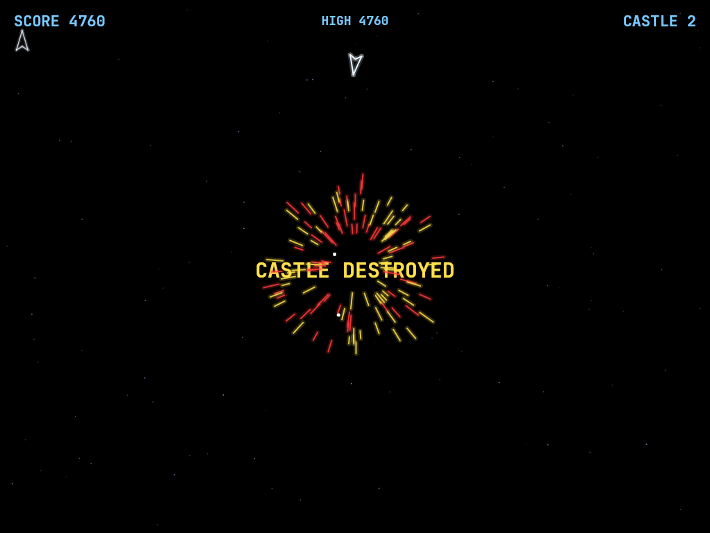

# AVACastle

A recreation of Cinematronics' 1980 vector arcade game **Star Castle**, built with .NET and Avalonia UI.
A cannon sits at the centre of the screen behind three counter-rotating energy rings. Shoot your way
through the rings, line up a gap, and hit the cannon, while it tracks you and fires through any opening it
can find, and homing mines hunt you down.

## Screenshots

| Title Screen | Gameplay | Castle Destroyed |
|:------------:|:--------:|:----------------:|
|  |  |  |

## Download and run

Ready-to-run builds for Windows, macOS and Linux, on both Intel/AMD and ARM, are on the
[Releases page](https://github.com/Harlock123/AVACastle/releases). **Latest build** is rebuilt on
every push to `main`. Each download is one self-contained executable: no .NET install is
needed.

```bash
tar -xzf AVACastle-linux-arm64.tar.gz     # or linux-x64, linux-arm, osx-arm64, osx-x64
./AVACastle
```

On Windows, unzip `AVACastle-win-x64.zip` (or `-win-arm64`) and run `AVACastle.exe`. On macOS, if
Gatekeeper refuses to open it, run `xattr -d com.apple.quarantine AVACastle` once.

### Linux: sound and gamepads

- **Sound** needs `aplay`, from the `alsa-utils` package. Without it the game runs but is
  silent. Minimal installs (Arch, Omarchy, some Raspberry Pi images) don't include it:

  ```bash
  sudo apt install alsa-utils             # Debian / Ubuntu / Raspberry Pi OS
  sudo pacman -S --needed alsa-utils      # Arch / Omarchy
  ```

- **Gamepads** use SDL2. It is bundled for Windows, macOS and Intel/AMD Linux, but **ARM Linux builds need it
  installed**. Without it the keyboard still works; only the controller does not:

  ```bash
  sudo apt install libsdl2-dev            # Debian / Ubuntu / Raspberry Pi OS
  sudo pacman -S --needed sdl2-compat     # Arch / Omarchy
  ```

  On Debian-based systems it has to be `libsdl2-dev`: the game looks for `libSDL2.so`, which
  the runtime-only `libsdl2-2.0-0` package doesn't provide.

## Requirements

- .NET 9.0 SDK
- Compatible with Windows, macOS, and Linux

SDL2 is bundled for Windows, macOS and Intel/AMD Linux; ARM Linux needs it installed (see
[Linux: sound and gamepads](#linux-sound-and-gamepads)).

## Building and Running

```bash
cd AVACastle
dotnet build
dotnet run
```

## Controls

### Keyboard

| Key | Action |
|-----|--------|
| **W** / **Up Arrow** | Thrust forward |
| **A** / **Left Arrow** | Rotate left |
| **D** / **Right Arrow** | Rotate right |
| **Space** | Fire |
| **M** | Mute / unmute |
| **ESC** | Pause game |
| **ESC** (while paused, or on the title screen) | Exit game |
| **Any key** (while paused) | Resume game |
| **Space** (on title / Game Over) | Start a game (or **X** on a controller) |

### Mouse

| Input | Action |
|-------|--------|
| **Left Button** | Fire |
| **Right Button** | Thrust forward |
| **Scroll Wheel** | Rotate ship |

### Controller (Xbox/PlayStation/Switch Pro)

| Input | Action |
|-------|--------|
| **Left Stick** / **D-Pad** | Rotate and thrust |
| **A** / **Right Trigger** | Thrust forward |
| **X** / **B** / **Bumpers** | Fire |
| **Start** | Pause / Resume game |
| **Back/Select** (while paused) | Exit game |

Controllers are automatically detected when connected. The game supports Xbox, PlayStation, Switch Pro, and most SDL2-compatible controllers.

### Other

| Key | Action |
|-----|--------|
| **Ctrl+S** / **Cmd+S** | Save screenshot to Pictures folder |

## Gameplay

- **The castle**: a cannon at the centre, behind three rings of 12 segments each. The outer ring
  and inner ring turn one way, the middle ring the other.
- **Breaking in**: each segment takes two hits. A damaged segment glows dimmer. Your shots stop at
  the first standing segment they meet, so you have to open holes and wait for them to line up.
- **Rings rebuild**: clear the whole outer ring and the middle and inner rings move out a slot each,
  while a fresh inner ring grows out of the core.
- **The cannon** turns to follow you. Whenever it has an open line to your ship through all three
  rings, it flares white and fires a big, slow starburst. Keep moving.
- **Mines** leave the core, drift out through the rings, then curve round and chase you. They burn
  out after a while, and can be shot.
- **The rings are solid**: your ship bounces off standing segments. Touch the cannon itself and
  you're done.
- **Destroying the cannon** blows up the whole castle and earns an extra ship. A new castle grows in
  its place, with faster rings, a quicker cannon and faster mines.
- You start with 3 ships; after losing one you reappear at the edge of the screen furthest from
  danger, briefly invulnerable (the ship flashes).
- The screen wraps around at the edges, for you and for the mines. The cannon's shots don't wrap.
- The high score is remembered between games.

## Scoring

| Target | Points |
|--------|--------|
| Outer ring segment | 10 |
| Middle ring segment | 20 |
| Inner ring segment | 30 |
| Cannon | 2000 + an extra ship |

## Sound Effects

All effects are synthesised by [`tools/make_sounds.py`](tools/make_sounds.py) into `Sounds/`; edit
it and run `python3 tools/make_sounds.py` to change them.

- **Fire**: your shot
- **Hit** / **Break**: a segment is damaged / destroyed (Hit also plays when you bounce off a ring)
- **Fireball**: the cannon fires
- **Mine**: a mine leaves the core
- **Regenerate**: the rings move out, or a new castle appears
- **Explosion** / **CastleBoom**: your ship / the castle is destroyed
- **ExtraLife**: an extra ship is awarded
- **Thruster**: loops while thrusting

## Project Structure

```
AVACastle/
├── AVACastle.sln
├── AVACastle.csproj
├── Program.cs
├── App.axaml / App.axaml.cs
├── MainWindow.axaml / MainWindow.axaml.cs
├── Images/                 # README screenshots
├── Models/
│   ├── GameObject.cs       # Base class with position, velocity, collision
│   ├── Ship.cs             # Player ship with thrust and rotation
│   ├── Bullet.cs           # Player shot; remembers its last position for swept ring hits
│   ├── Ring.cs             # One rotating 12-segment energy ring
│   ├── Castle.cs           # The three rings and the tracking cannon
│   ├── Fireball.cs         # The cannon's shot
│   ├── Mine.cs             # Homing mine
│   └── Explosion.cs        # Coloured particle explosions
├── Engine/
│   ├── GameEngine.cs       # Game loop, state, collisions, scoring, high score
│   ├── InputHandler.cs     # Keyboard, mouse, and controller input
│   ├── ControllerManager.cs # SDL2 gamepad support
│   └── SoundManager.cs     # Cross-platform audio playback
├── Views/
│   └── GameCanvas.cs       # Scales the 1024x768 playfield to the window and draws it
├── Sounds/                 # Generated WAV effects
└── tools/
    └── make_sounds.py      # Synthesises the sound effects
```

## Technical Details

- **Framework**: Avalonia UI 11.x on .NET 9
- **Audio**: NetCoreAudio for cross-platform sound playback
- **Controller**: SDL2 GameController API for cross-platform gamepad support
- **Rendering**: Custom `Control` with `DrawingContext`. Every line is drawn twice, wide and faint and
  then thin and bright, for a vector-monitor glow. The ring colours come from their position on
  screen, the way the original cabinet coloured its black-and-white monitor with a plastic overlay.
- **Playfield**: a fixed 1024x768 field, scaled to fit any window size with letterboxing
- **Ring hits**: tested along the path each bullet travelled that frame, so fast shots can't skip
  through a ring between frames
- **Game Loop**: 60 FPS using `DispatcherTimer`
- **High score**: saved to `AVACastle/highscore.txt` in the user's application-data folder
- **Screenshots**: Captured using `RenderTargetBitmap` and saved as PNG

## Credits

Star Castle was designed by Tim Skelly and programmed by Scott Boden for Cinematronics (1980). This is
a fan recreation of its gameplay; no code, graphics or sound from the original are used.

## License

MIT License
